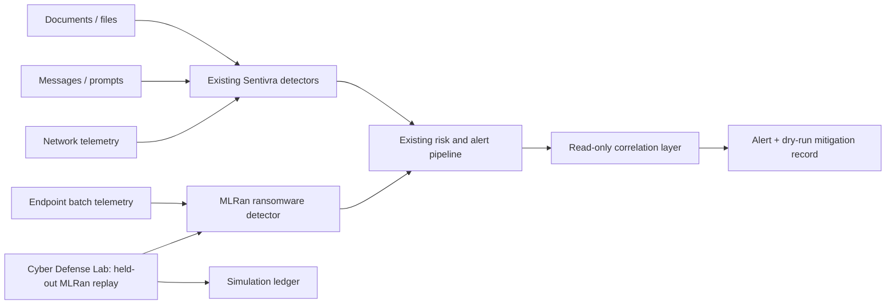

# SENTIVRA ransomware detection

## Status and honesty boundary

SENTIVRA now has an **opt-in MLRan behavioral ransomware capability**. It is a
binary classifier over 483 feature-selected behavioral values. It does not
receive malware binaries, execute samples, watch the host, encrypt files, alter
the registry, launch processes, or make network calls.

`RANSOMWARE_MODEL_ENABLED` defaults to `false`. With the flag disabled, or when
the verified artifacts under `models/ransomware/mlran/` are missing, the new
detector is not registered/available and existing Sentivra detectors and APIs
retain their previous behavior.

RanDe-W11 was **not** used as a pretrained model. The inspected RanDe-W11
repository contains methodology, a feature guide, preprocessing scripts,
figures, and a 10-row preview; it does not contain deployable model weights.
RanDe is used here only as a methodological reference for ordered behavioral
features and leakage auditing.

## Architecture



The other Sentivra detectors continue to inspect endpoint surfaces such as
networks, messages, documents/files, prompts, endpoint activity, URLs, and SQL.
The ransomware score is one additional signal. The additive correlation helper
can associate a ransomware finding with already-produced document, message, or
network signals as a `ransomware_attack_chain` incident. It does not rewrite the
source detector outputs.

## Data and preprocessing

Training uses the feature-selected MLRan split from
`faithfulco/mlran/6_experiments/FS_MLRan_Datasets`:

- 3,905 training rows and 975 held-out test rows.
- 483 numeric behavioral features.
- Train class balance: 2,040 benign and 1,865 ransomware.
- Held-out test class balance: 510 benign and 465 ransomware.
- No missing feature values were present.
- 901 exact feature duplicates were observed in the training matrix and were
  reported, not silently removed.
- Label and metadata columns (`sample_type`, `family_label`, `type_label`) were
  excluded from the feature matrix.
- A column-name and feature-value keyword audit found no label-proxy hits.
- Validation groups are ransomware family labels; benign rows are placed into
  deterministic benign-only groups so every fold contains both classes.

The reproducible command is:

```text
backend/.venv/Scripts/python.exe scripts/train_ransomware_model.py \
  --data-dir data/mlran \
  --output-dir models/ransomware/mlran \
  --trials 8
```

The downloaded data is gitignored. The model artifacts, schema, metrics,
threshold, figures, and explainability rankings are stored under
`models/ransomware/mlran/`.

The training run used MLRan source commit `273fcac5af82ad60d60fa2bff427ebcb1db61273`
and recorded these input hashes in `models/ransomware/mlran/metadata.json`:

- `MLRan_X_train_RFE.csv`: `aaf75d5754aac247b93e2a7d0baa449ccb3eacc08117f50dfa0fb422aff3db1f`
- `MLRan_X_test_RFE.csv`: `792e7bea9ccfe8bb056a05bc4751ebf18311c55e548d1b80910214c052ee8e16`
- `MLRan_labels.csv`: `1e00f2e11e02a34859e8863808422933988c151e8c821a88247798b051227e4f`

The inspected RanDe-W11 methodology source was commit
`62c615684303dd82ab14f882e52ce205b9515078`.

## Measured model comparison

The following are five-fold `StratifiedGroupKFold` results on the training
split, grouped by family. Values are generated in `metrics.json`; percentages
below are rounded only for readability.

| Candidate | Accuracy | Balanced accuracy | Precision | Recall | F1 | ROC-AUC | False-positive rate |
|---|---:|---:|---:|---:|---:|---:|---:|
| XGBoost | 98.41% | 98.40% | 98.39% | 98.28% | 98.33% | 99.82% | 1.47% |
| LightGBM | 98.51% | 98.50% | 98.55% | 98.34% | 98.44% | 99.90% | 1.33% |
| RandomForest | 98.67% | 98.66% | 98.61% | 98.60% | 98.61% | 99.87% | 1.28% |
| ExtraTrees | 98.75% | 98.73% | 98.92% | 98.44% | 98.68% | 99.88% | 0.98% |
| LogisticRegression | 99.00% | 98.99% | 99.09% | 98.82% | 98.95% | 99.94% | 0.83% |

The selected model is the LogisticRegression candidate because it had the
strongest group-held-out validation profile under the fixed seed. LightGBM was
tuned with eight bounded Optuna trials. XGBoost, LightGBM, RandomForest,
ExtraTrees, and LogisticRegression were all trained and compared.

### Threshold and held-out test

The alert threshold was selected only from out-of-fold training predictions to
target recall of at least 0.98. The selected threshold is **0.685108**.

Validation at that threshold:

- Recall: **98.02%**
- Precision: **99.67%**
- F1: **98.84%**
- False-positive rate: **0.29%**

On the untouched supplied MLRan test split:

- Accuracy: **97.54%**
- Balanced accuracy: **97.53%**
- Precision: **97.42%**
- Recall: **97.42%**
- F1: **97.42%**
- ROC-AUC: **99.59%**
- False-positive rate: **2.35%**

These are dataset measurements, not a guarantee of live-host performance. The
held-out test contains 35 family labels and is not a substitute for deployment
validation on an organization’s endpoint telemetry.

## Explainability

SHAP global explanations were generated and stored in
`models/ransomware/mlran/shap_global.json`; the figure is
`models/ransomware/mlran/figures/shap_summary.png`. The highest measured global
mean-absolute contributions include:

1. `STRING:!this program cannot be run in dos mode.`
2. `SIGNATURE:packer_entropy`
3. `STRING:\`.rdata`
4. `STRING:@.data`
5. `STRING:kernel32.dll`
6. `API:NtOpenProcess`
7. `API:RegEnumKeyExW`
8. `FILE:OPENED:c:\`

These are behavioral/static telemetry features in MLRan, not proof that any one
feature is malicious. Per-prediction evidence reports the model probability,
threshold, and top observed globally-ranked features.

## Live API path

With the opt-in flag enabled and artifacts present:

- `GET /api/v1/ransomware/health` reports artifact availability and version.
- `POST /api/v1/ransomware/predict` accepts a bounded 483-feature behavioral
  vector and sends the result through the existing event, risk, alert, and audit
  pipeline.

The feature-vector path accepts behavioral values only. It does not accept a
file path or binary and does not perform host inspection. A missing or malformed
vector fails closed as unavailable/invalid input.

## Cyber Defense Lab simulation

The Lab exposes two trusted ransomware scenarios:

1. **MLRan ransomware replay** reads one fixed ransomware row from the local,
   gitignored held-out test CSV and sends only its feature vector through the
   detector.
2. **Ransomware attack-chain replay** uses the same held-out vector plus trusted
   synthetic document, message, and network detector signals. It demonstrates
   read-only correlation and reports a dry-run mitigation plan.

Both modes are host-safe by construction:

- No real malware is downloaded or executed.
- No files outside `data/mlran` are read or modified.
- No registry, process, persistence, network, or backup operation is performed.
- “Isolation”, notification, and network-indicator actions are recorded as
  dry-run intentions only; `real_world_action_taken` remains false.

The replay is a pipeline demonstration. It is not a live endpoint benchmark,
and it does not claim OS-level isolation. A separate dummy-folder mode was not
implemented because the default dataset replay provides the requested host-safe
demonstration without touching the host filesystem.

## Limitations and threats to validity

- MLRan is Cuckoo-derived behavioral data; RanDe is Any.run/Windows 11
  methodology. Their schemas are not merged.
- The full RanDe dataset was not supplied, so no cross-dataset score is claimed.
- Dataset-trained scores do not transfer 1:1 to live hosts.
- Family-held-out folds reduce family leakage but do not replace temporal,
  organizational, or adversarial validation.
- A high probability is a detector signal, not proof of compromise.
- Existing Sentivra risk aggregation remains the authoritative alert decision;
  the ransomware model is not a replacement for the other detectors.
- Mitigation is dry-run only in this build.

## Citations

- Faithful, C. et al. **MLRan: A Behavioural Dataset for Ransomware Analysis
  and Detection**, MLRan repository (MIT),
  [GitHub](https://github.com/faithfulco/mlran), dataset record
  [Zenodo](https://zenodo.org/records/23403681), paper
  [arXiv:2505.18613](https://arxiv.org/abs/2505.18613).
- Ferdous, J., Islam, R., Mahboubi, A., and Islam, M. Z. **RanDe: A Realistic
  Behavioral Dataset for Machine Learning-Based Ransomware Detection**,
  [RanDe-W11](https://github.com/rande-code/RanDe-W11), CC BY 4.0. RanDe is
  cited here as methodology/schema reference; no RanDe pretrained model is
  used.
